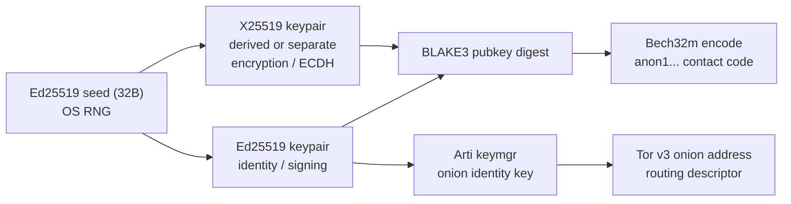
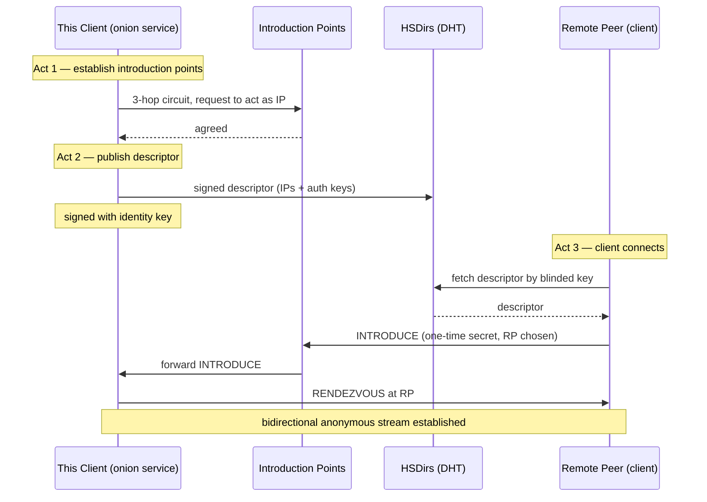
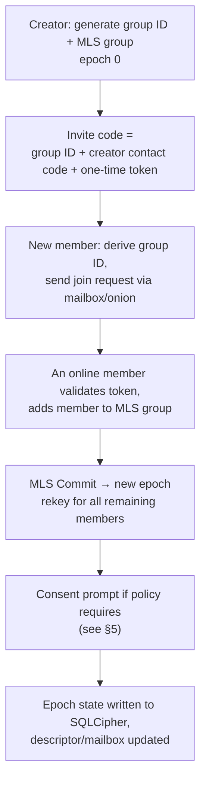

# Project Plan: Truly Serverless, Anonymous P2P Communication Application

**Target stack:** Rust + Tauri v2 (desktop) with a mobile target, plus an embedded Tor client (Arti).

**Status:** Engineering blueprint — pre-implementation. Technical claims below were verified against upstream sources where marked ✅.

---

## 1. Executive Summary & Core Principles

This document outlines the engineering blueprint for a desktop and mobile communication application built with Rust and Tauri v2. The application guarantees zero central server dependency, complete IP address masking via Tor (Arti), local-only encrypted storage with a mandatory 90-day retention ceiling, and automated cryptographic key management backed by explicit user consent prompts.

### Core Architecture Goals

- **Absolute Anonymity**: 100% of network traffic routes through the Tor network (via embedded Arti) or direct onion-routed peer-to-peer tunnels. Real IP addresses and metadata are never leaked.
- **Zero-Server Topology**: No central registry, user database, or message relay servers. Discovery and messaging occur via cryptographic addressing and distributed rendezvous mechanisms.
- **Local-First & Ephemeral Storage**: All conversations are stored exclusively on-device in an encrypted SQLite (SQLCipher) database with a strict 90-day automated TTL purge policy.
- **Automated Security with Consent**: Complex background tasks—such as group key rotation and epoch handshakes—are fully automated in the Rust backend, but trigger an explicit interactive prompt requiring user agreement when state changes occur.

### 1.1 Glossary

| Term | Meaning |
| --- | --- |
| **Arti** | Tor's official Rust implementation of the Tor protocol; usable as an embeddable client library (`arti-client`). |
| **Onion Service (v3)** | A service reachable only via Tor whose address *is* its public identity key. Provides bidirectional anonymity. |
| **Introduction Point (IP)** | A Tor relay that accepts connection requests on behalf of an onion service. |
| **Rendezvous Point (RP)** | A Tor relay where client and service meet and which relays traffic between them. |
| **HSDir** | Hidden Service Directory — Tor relays that store signed onion-service descriptors. |
| **Descriptor** | Signed document listing an onion service's introduction points and auth keys, published to HSDirs. |
| **MLS (RFC 9420)** | Messaging Layer Security — IETF group key-agreement protocol for scalable forward secrecy. |
| **Epoch** | The time-bounded generation of a group key; rotation advances the epoch. |
| **TTL** | Time-to-live — here, the 90-day maximum local retention of any message. |

### 1.2 Non-Goals (explicitly out of scope)

Naming these now prevents scope drift and architectural ambiguity later.

- **No clearnet fallback.** There is no mode that degrades to direct TCP/IP. If Tor is unavailable, the app is offline for internet messaging.
- **No central relay.** No hosted inbox, no push-notification broker, no directory server, no STUN/TURN, no analytics endpoint.
- **No metadata protection beyond transport + padding.** Tor hides IP and network path; it does not hide message timing, size, or social-graph patterns from the peers themselves.
- **No multi-device sync of message history.** Keys may be recoverable, but conversation history stays device-local (subject to TTL).
- **No offline-recipient delivery guarantees.** If no group member is online, delivery is best-effort and may be delayed indefinitely.
- **No deniability guarantee at the protocol layer.** Message authenticity is signed; receipt non-repudiation is a design decision to revisit (see §13).

### 1.3 Resolved Decisions

These were open questions in the first draft and are now **decided**; the rest of the document reflects them.

| # | Decision | Choice | Affects |
| --- | --- | --- | --- |
| D1 | Group key management | **MLS via `openmls` 0.9.2** (RFC 9420), not a hand-rolled shared key | §4.2, §5 |
| D2 | Arti integration | **Embed `arti-client` + `tor-hsservice` behind an `AnonymityTransport` trait** | §3.4, §7 |
| D3 | TTL enforcement | **Integer `expires_at` + `STRICT` tables + crypto-shredding** | §6.1–6.2 |
| D4 | Rotation consent | **Batch routine rotations; blocking prompt only for removals and manual rotations** | §5.2 |
| D5 | Key backup & recovery | **Optional, user-held encrypted seed escrow** — no server, user stores the artifact | §2.5 |
| D6 | Mobile scope | **Desktop *and* mobile in v1, with opportunistic delivery** | §8 |
| D7 | Onion address lifetime | Persist onion identity key so contact addresses stay stable across restarts | §3.2 |
| D8 | Restricted discovery | **Enabled by default** for 1-on-1 contacts; opt-in for large/public groups | §3.2, §4.3 |

**Consequences of D5 and D6** (both differ from the initial recommendation and change work):

- **D5** adds a real, user-facing **export/import** flow and its threat model (§2.5). Escrow is optional, so the "no recovery" path must still work.
- **D6** promotes mobile from "later" to **v1 scope**, which means the mobile background limitations in §8 are now *launch-blocking constraints*, not future concerns. Phases 0–5 must each be validated on mobile, and the opportunistic-delivery model must be honest in the UI from day one.

---

## 2. Identity & Cryptographic Addressing

Users do not register with phone numbers, emails, or usernames. Identity is entirely self-sovereign and mathematically generated locally. But allow them to set names.

> **Design note on names:** A display name is *unauthenticated metadata*. It must not be treated as identity. Names are local aliases unless a peer signs and shares them; two peers can claim the same name. Treat the cryptographic code as the only durable identifier and surface name collisions to the user.

### 2.1 Keypair Generation & Identity

- **Asymmetric Engine**: On first launch, the Rust backend generates an Ed25519 keypair for identity/signing and an X25519 keypair for encryption/Diffie-Hellman handshakes.
- **The Unique Code**: The public keys are hashed (BLAKE3) and encoded into a human-shareable Bech32 string or a Tor v3 `.onion` style format (e.g., `anon1qxy2kgdygjrsqtzq...`).
- **Storage**: Private keys are kept in secure local storage (OS keychain or encrypted file via SQLCipher) and marked with zeroize routines so they never persist in plaintext memory longer than necessary.

> **✅ Verification note on the address format:** A real Tor v3 onion address is **not** an arbitrary BLAKE3 hash — it is `base32(SHA3-256(permanent_pubkey ‖ blinded_pubkey ‖ version)[:35]) ‖ ".onion"`, where the permanent key is Ed25519 with a key-blinding step (`rend-spec-v3`). Therefore the "unique code" in §2.1 is **your own app-level identifier**, which is a different thing from the onion service's address (§3.2). Do not conflate them. Recommended split:
>
> - **Identity/contact code** (`anon1...`, Bech32m-encoded): derived from the Ed25519 identity public key. This is what humans copy and paste to add a contact.
> - **Onion address** (`...onion`): generated by Arti for the local hidden service, used for routing only, and rotated/blinded independently of identity.



### 2.2 Identity Code Specification (proposed)

| Field | Value |
| --- | --- |
| Payload | `version (1 byte) ‖ Ed25519_pubkey (32 B) ‖ X25519_pubkey (32 B)` |
| Checksum | BLAKE3 of payload, truncated to 4 bytes |
| Human prefix | `anon1` (Bech32 HRP = `anon`) |
| Encoding | **Bech32m** — use `bech32` crate ≥ 0.11 |
| Encoding rationale | ✅ Bech32 spec lists BIP-350/Bech32m as preferred for *new* applications that carry no size constraint. |
| Length | Long by design; the UI should offer QR code + copy button, not manual transcription. |

### 2.3 Key Storage & Zeroization

- **Primary store:** OS-native secret store where available — Windows **DPAPI/Credential Manager**, macOS **Keychain**, Linux **Secret Service / libsecret**; use the `keyring` crate as a portable facade. Fallback: key material inside the SQLCipher database, itself unlocked by an Argon2id-derived passphrase.
- **Never** write private keys to plaintext files, logs, crash dumps, or the Tauri webview.
- **Zeroize:** wrap all secret buffers in `Zeroizing<Vec<u8>>` / `ZeroizeOnDrop` types. Note that `zeroize` cannot scrub copies the compiler or allocator made for you; keep secrets in exactly one owning buffer and avoid unnecessary `clone()`/`to_vec()`.
- **Explicitly out of scope for zeroize:** OS keychain values once handed to the OS, and process dumps permitted by the OS.
- **Backup/recovery (D5 — decided):** optional, user-held encrypted seed escrow. Design in §2.5. The no-recovery path must remain fully supported.

### 2.4 Threat Model (abbreviated)

Because this app's promise is "absolute anonymity", the threat model must be explicit about what it does and does not defend against.

| Threat | Mitigated? | Mechanism / caveat |
| --- | --- | --- |
| Peer learning your IP | ✅ | Tor onion services; IP is not part of the protocol. |
| Network observer (ISP) | ✅ | Traffic is onion-encrypted to the RP; observer sees only Tor traffic. |
| Malicious/compromised peer | ⚠️ Partial | Peers see message content by design; transport metadata (timing/size) is visible. |
| Compromised device (malware, unlocked disk) | ❌ | Local DB is encrypted at rest, but a running app with unlocked keys is exposed. |
| Global adversary correlating timing | ❌ | Tor does not defeat end-to-end traffic correlation. |
| Sybil on group membership | ⚠️ Partial | Invite-code possession is the trust root; no out-of-band identity verification. |
| Metadata: message size/timing | ⚠️ Partial | Requires padding + batching policy (§9.4). |
| Key deletion after rotation | ✅ | Forward secrecy via ratchet/MLS epoch advance (§5). |
| Device loss (no backup made) | ❌ | Identity is unrecoverable by design — state this plainly in the UI. |
| Escrow artifact theft | ⚠️ Partial | Mitigated by strong passphrase + Argon2id (§2.5); the artifact is offline-only. |

### 2.5 Key Backup & Recovery — Optional User-Held Seed Escrow (D5)

Recovery is **optional and entirely user-controlled**. There is no server, no cloud, no escrow agent, and no recovery code that the app can regenerate for you.

**Artifact design:**

| Property | Value |
| --- | --- |
| Contents | Ed25519 seed (32 B) ‖ X25519 secret (32 B) ‖ version ‖ checksum |
| Encryption | AEAD (`chacha20poly1305` or `aes-gcm`) with a key from Argon2id over a user-chosen passphrase |
| KDF parameters | Same **mobile-calibrated** parameters as §6.3; store them in the artifact header so future restores stay compatible |
| Encoding | Bech32m or Base32, human-copyable, plus QR |
| Presentation | Shown once, user must acknowledge they stored it; never re-displayed without re-authentication |
| Storage | **Out of scope for the app** — the user writes it down, prints it, or saves it themselves |

**Threat model for the escrow:**

- The artifact is **offline**; if the user stores it in a cloud drive, the cloud becomes the escrow agent and the "no server" claim must be qualified in the UI.
- Passphrase strength is the entire security margin. Enforce a minimum length and estimate entropy; warn on weak passphrases **without silently rejecting** user choice.
- Brute-force resistance rests on Argon2id parameters recorded in the artifact — do **not** lower them for the export path.
- A stolen artifact + weak passphrase is a full identity compromise, including the ability to impersonate the user. Surface this at export time.

**Import flow:** parse artifact → Argon2id → decrypt → load keypair → verify contact code matches any previous one → restore sessions. Imported identity keeps the **same contact code**, since it derives from the same seed. Onion addresses are re-registered via Arti's key manager (§3.2).

**Because recovery is optional, the "device lost = identity lost" path must be documented, tested, and communicated at first-run** — a user who opts out and later loses the device must not be surprised.

> **Note:** group membership (MLS state) is **not** included in the escrow. Restoring identity does not restore group keys; the restored user must rejoin groups via an invite. This preserves forward secrecy and is a deliberate limitation.

---

## 3. Network Transport & IP Anonymity (100% Tor / P2P)

To ensure absolute identity and IP protection, the app completely bypasses standard clearnet routing.

### 3.1 The Tor Backbone: Embedded Arti

- **Arti Integration**: Instead of depending on a system-installed Tor binary, embed Arti (Tor's official Rust implementation) directly inside the Tauri v2 binary as a background runtime thread.
- **Onion Services (V3 Rendezvous)**:
  - Every running client instance spins up a local Tor v3 hidden service instance.
  - Direct 1-on-1 and group communication occurs via Tor Rendezvous Points.
  - Neither peer ever learns the other's real IP address; packets are multi-layer onion encrypted across the Tor network.
- **Direct P2P Fallback (Encrypted Mesh)**: If local connections or alternative transport layers are used (e.g., local Wi-Fi mesh or direct hole-punching), they must be encapsulated within Noise Protocol / X25519 encrypted streams, though Tor remains mandatory for internet-wide routing to prevent IP exposure.

> **✅ Verification notes — read before Phase 2**
>
> 1. **Arti is pre-1.0 and its API is unstable.** Latest published `arti` crate is **2.7.0** (Oct 2026); the CLI crate README still warns its interface is not stable. Pin exact versions in a lockfile and expect breaking upgrades.
> 2. **The `arti` crate is the CLI binary, not the library.** For embedding, depend on **`arti-client`** (the library interface) — this is the crate the Arti README explicitly points to for a "more general Tor client library interface."
> 3. **Onion *service* (server) support is the newest, least-stable surface.** As of the current stable Arti README, "onion services and bridges won't work (Arti doesn't support them yet)" is still stated for general use; the server-side implementation lives in **`tor-hsservice` 0.47.0**, whose stable features are minimal and whose meaningful capabilities (`hs-pow-full`, `negotiate-extensions`) sit behind `experimental` flags. **Client-side** onion connections via `onion-service-client` are further along than hosting.
> 4. **Risk:** hosting an onion service from an embedded Arti inside a Tauri app is the highest-risk dependency in this plan. Mitigation options ranked in §3.4.
> 5. **No clearnet fallback** must be enforced in code, not by convention: bind all sockets to the Arti SOCKS/data-stream interface and add a lint/test that fails on any direct `TcpStream` outside the Tor module.

**Verified upstream facts:**

| Fact | Value | Source |
| --- | --- | --- |
| `arti` crate latest | 2.7.0 (updated 2026-10-01) | crates.io API ✅ |
| `arti-client` | the embeddable library | Arti README ✅ |
| `tor-hsservice` latest | 0.47.0 | crates.io API ✅ |
| Tor v3 address derivation | `base32(SHA3-256(pubkey ‖ blinded_pubkey ‖ 0x03)[:35]).onion` | `rend-spec-v3` ✅ |
| Onion service crypto | Ed25519 + Curve25519 + SHA3-256 + SHAKE256 | `rend-spec-v3` ✅ |
| Onion service NAT behavior | outbound-only; no open ports needed | Tor community docs ✅ |

### 3.2 Onion Service Lifecycle (per instance)

Modeled directly on the Tor v3 three-act flow (✅ verified against `rend-spec-v3` overview):



**Implementation notes:**

- **Ephemerality:** the onion service need only run while the app is open and willing to receive. Deterministic, stable addresses require persisting the onion identity key in Arti's key manager across restarts; otherwise each launch yields a new address that contacts must re-learn. Decide per-feature (contacts vs. group mailboxes).
- **Restricted discovery (formerly "client authorization"):** ✅ supported in v3 as an optional mode. Per-contact authentication keys can make a descriptor unreadable to anyone without the key — a strong fit for 1-on-1 addresses. Requires distributing each client's auth key out of band.
- **PoW defense:** onion services are subject to DoS via introduction-point flooding; `hs-pow-full` is available in `tor-hsservice` but flagged experimental. Plan a rate-limit/queue at the app layer regardless.

### 3.3 Two Distinct Connection Modes

| Mode | Initiator anonymity | Responder anonymity | Use |
| --- | --- | --- | --- |
| Onion service rendezvous | ✅ | ✅ (bidirectional) | Contacts, group mailboxes, all internet messaging |
| Plain Tor stream to a clearnet host | ✅ | ❌ | **Disallowed** by this design |

### 3.4 Arti Risk Mitigation (ranked)

1. **Preferred — embed `arti-client` + `tor-hsservice`, pin versions, wrap in an internal trait.** Isolate every Arti call behind an `AnonymityTransport` trait so the backend can be swapped without touching messaging logic.
2. **Fallback — ship Arti as a sidecar process** launched/managed by the Tauri backend, communicating over a local socket. Keeps API churn out of the main binary and allows shipping a separately-patched Arti.
3. **Last resort — supervise the C Tor binary** as a sidecar with a SOCKS + control port. Rejected if it means depending on a user-installed Tor; acceptable only if bundled and must still be treated as a workaround, not the target architecture.

Regardless of option, the app must **fail closed**: if the transport is not confirmed to be Tor, no message is sent and the UI says "offline — anonymity unavailable".

---

## 4. Serverless Group Chats & Decentralized Sync

Group coordination happens peer-to-peer without central servers.

### 4.1 Group Mechanics

- **Master Keys**: Group creation generates a master Ed25519 group keypair and a shared symmetric group conversation key.
- **Invite Codes**: Sharing the long unique group code allows new peers to derive group keys locally and request inclusion from active online group members.
- **Decentralized Mailboxes**: Since group members may not be online simultaneously, active peers host lightweight, temporary encrypted rendezvous mailboxes via their local Tor hidden service to buffer offline messages, subject to the same strict encryption and expiration rules.

### 4.2 Recommended: MLS instead of a monolithic group key

> **Design note (important):** A single shared symmetric key that every member holds means **removing one member requires re-keying every remaining member**, and *any* member — including any compromised one — can decrypt *all* past traffic encrypted under that key. Both properties are exactly what forward secrecy and post-compromise security exist to prevent. Use a vetted group protocol rather than hand-rolling this.

**Recommendation:** adopt **MLS (RFC 9420)** via the `openmls` crate.

| Property | Naive shared group key | MLS (openmls) |
| --- | --- | --- |
| Member removal | re-key all, break past secrecy | epoch advance; removed member locked out ✅ |
| Forward secrecy | ✗ | ✅ |
| Post-compromise security | ✗ | ✅ (via Commit healing) |
| Group scale | O(n) handshakes | logarithmic |
| Complexity | low to build, high to get right | high to build, well-specified |

**Verified:** `openmls` latest stable **0.9.2** (2026-10-22), tagged "A Rust implementation of the Messaging Layer Security (MLS) protocol, as defined in RFC 9420", keywords `e2ee / ietf / mls / rfc9420` ✅. It offers a `sqlite-provider` feature that can persist group state directly into SQLCipher.

For **1-on-1** chats, use the **Double Ratchet** (or MLS with a 2-member group) via a vetted crate; do not invent a ratchet.

### 4.3 Membership, Invites, and Trust



- **Invite code composition:** never let the invite code *be* the group secret. It should carry a group identifier plus a **one-time, expiring, single-use token** that an online member validates. Possession of the code alone must not grant decryption of history.
- **Trust root:** the creator's contact code inside the invite is the only authenticated element. Everything downstream (which member approved you, whether the member list is honest) is peer-asserted. Document this.
- **Removal:** a removal is an MLS `Remove` + `Commit`; the removed member cannot decrypt subsequent epochs. It cannot un-see what it already saw.
- **Group addresses:** prefer **restricted-discovery onion addresses** per group mailbox so HSDir-listed descriptors are not openly enumerable.

### 4.4 Offline Mailbox Design

Mailboxes are the weakest link: they are third-party (peer-hosted) storage under hostile conditions.

| Requirement | Design |
| --- | --- |
| Confidentiality | MLS application ciphertext — mailbox can never read contents |
| Integrity | AEAD + signature over ciphertext |
| Disappearance | Messages are TTL-bound on the host too; enforce `-90d` server-side, matching local |
| Abuse | Enforce per-sender quota + total-size cap, or a peer can fill the host's disk |
| Availability | A departing host loses buffered mail → warn: mailbox is best-effort, not durable |
| Attestation | Hosts should sign a "received-at / expires-at" receipt so senders can infer loss |
| Privacy | Mailbox host learns *who is in the group* and *when they send*, though not content |

**Policy decisions to make (§13):** max buffered bytes per mailbox; whether a host may be a non-member; whether to shard mailbox duty round-robin across online members.

---

## 5. Automated Background Operations & User Consent

Complex security hygiene tasks like key rotation (epoch shifts when members join/leave or time lapses) and database maintenance are heavily automated in the backend, but designed with a human-in-the-loop consent gate.

### 5.1 Workflow for Automated Key Rotation

1. **Trigger Detection**: The Rust backend detects a security event requiring rotation (e.g., a member leaves a group, a 30-day epoch boundary is reached, or a manual rotation is requested).
2. **Drafting State**: The backend pre-computes the new cryptographic keys, builds the updated group state payload, and signs it.
3. **Consent Prompt**: Before executing the state change and broadcasting the new key to peers, the UI pauses and displays an interactive modal:
   - **Prompt Example**: "Security Policy Update: A routine 30-day key rotation is required to maintain forward secrecy for 'Project Sigma'. Do you wish to apply this update now?"
4. **Execution**: Upon user approval, the Rust backend executes the rotation, updates the local SQLCipher database, and propagates the encrypted handshake over Tor.

### 5.2 Consent Gate: Design Constraints

The consent prompt is a **security control**, not a notification. It must be designed so it cannot be bypassed or weaponized.

| Constraint | Rationale |
| --- | --- |
| **Fail closed** | Rotation is *required* for forward secrecy. If the user ignores or denies the prompt, the app must warn that the group is now operating on a stale epoch, and either block sending or mark messages as "not forward-secret". Silently continuing is worse than prompting. |
| **Single source of truth in Rust** | The Rust side owns rotation state. The frontend cannot approve a rotation it invented; it can only approve a signed, pre-computed proposal emitted by the backend. |
| **Rendered from a signed payload** | The modal must display data the user can act on: group name, epoch number before→after, member count, reason (monotonic/remove/manual). Hash/ID the proposal so approval binds to *that* proposal, not "any rotation". |
| **Idempotent + replay-safe** | If the app closes mid-prompt, the drafted rotation must either resume or be safely re-derivable. Approvals must carry a nonce so an old approval cannot be replayed. |
| **Bounded wait** | Include an explicit timeout; on expiry, do not auto-approve. Surface the pending state in the UI. |
| **Auditability** | Log (locally, TTL-bound) every consent decision with the proposal ID. |

> **⚠️ Usability risk:** a modal on every rotation (e.g., a busy group with frequent joins/leaves) trains users to click through security prompts — the classic "consent fatigue" failure. Recommended policy: **batch** rotations within a window where possible, and reserve *blocking* prompts for high-impact changes (member removal, manual rotation, epoch jump beyond policy) while showing non-blocking, batched confirmations for routine time-based rotations.

### 5.3 Other Automated Background Tasks

| Task | Trigger | Consent? |
| --- | --- | --- |
| Epoch rotation (time-based) | 30-day boundary | Non-blocking confirm / batched |
| Epoch rotation (member removed) | MLS `Remove` | **Blocking prompt** |
| Epoch rotation (manual) | User action | User initiated |
| 90-day TTL purge | Startup + every 24h | No — policy-managed, disclosed in settings |
| `VACUUM` after purge | After each purge | No |
| Key backup/export | User action only | **Always explicit** |
| Arti/transport health check | Startup + periodic | No |
| Mailbox pruning (host side) | Every 24h | No |

---

## 6. Local Storage & Mandatory 90-Day TTL Enforcement

Data retention is strictly constrained locally to protect user privacy.

- **Database Layer**: SQLite encrypted via SQLCipher, with master keys derived using Argon2id.
- **Zeroize Memory**: Sensitive strings, keys, and message plaintexts use the zeroize crate to wipe memory immediately upon completion of tasks.
- **90-Day Retention Policy**:
  - An automated background routine executes upon application startup and every 24 hours:

    ```sql
    DELETE FROM messages WHERE timestamp < strftime('%s', 'now', '-90 days');
    ```

  - A subsequent VACUUM command runs to wipe unallocated disk sectors containing purged message blocks.
  - Users are explicitly informed in the settings menu that data cannot exceed 90 days and is permanently purged by design.

### 6.1 ⚠️ Correction to the Purge Query

> **The query as written is only correct if `timestamp` is stored as Unix epoch seconds.** `strftime('%s', ...)` returns a *string of digits* in SQLite; comparing it against an ISO-8601 text column performs a **string comparison**, and SQLite's `TEXT` ordering is coercible in surprising ways against integer columns. This silently purges nothing — or purges the wrong range — while appearing to succeed.

**Adopt an explicit, integer-typed schema and query:**

```sql
-- Schema: time is stored as INTEGER epoch seconds, NOT text.
CREATE TABLE IF NOT EXISTS messages (
  id            BLOB PRIMARY KEY,        -- ULID/UUIDv7
  conversation  BLOB NOT NULL,
  sender        BLOB NOT NULL,
  sent_at       INTEGER NOT NULL,        -- epoch SECONDS (UTC)
  received_at   INTEGER NOT NULL,
  expires_at    INTEGER NOT NULL,        -- sent_at + 90d, precomputed at insert
  ciphertext    BLOB NOT NULL,
  epoch         INTEGER,
  CHECK (expires_at > sent_at)
) STRICT;

CREATE INDEX IF NOT EXISTS idx_messages_expires_at ON messages (expires_at);

-- Purge by the precomputed absolute expiry, not by re-deriving 'now - 90 days'.
DELETE FROM messages WHERE expires_at <= CAST(strftime('%s','now') AS INTEGER);
```

Why `expires_at` beats re-deriving the window:

- A `CREATE INDEX` on `expires_at` turns purge into a cheap index scan instead of a full-table scan — meaningful on constrained mobile storage.
- `STRICT` tables (SQLite ≥ 3.37) reject type confusion outright, so the bug above is *impossible* rather than merely absent.
- Precomputing expiry pins the retention clock to **receipt/send time**, so a clock change or long offline period cannot silently extend retention.

### 6.2 ⚠️ Reality Check on `VACUUM` as a Wipe

> **`VACUUM` is a logical compaction, not a guaranteed physical erase.** It rebuilds the database file and drops the freelist, which usually makes purged rows unrecoverable through normal means — but it does **not** guarantee the original blocks are overwritten on flash storage (SSDs and eMMC wear-level, and FTL may retain old blocks), nor does it `fsync`-overwrite the old file. Do not advertise "permanently purged" on the strength of `VACUUM` alone.

Layered approach, honest about limits:

| Layer | Measure | Guarantee |
| --- | --- | --- |
| 1 | Delete rows, then `PRAGMA secure_delete = ON` | Overwrites deleted content with zeros in the DB file |
| 2 | `VACUUM` (or `PRAGMA incremental_vacuum` with `auto_vacuum`) | Removes freelist pages; compacts the file |
| 3 | Encrypt at rest (SQLCipher) | Even remnant blocks are ciphertext |
| 4 | **Crypto-shredding** (recommended): derive a per-time-bucket key, and *destroy the key* when the bucket expires | Strongest practical guarantee — leftover ciphertext is undecryptable regardless of storage |
| 5 | OS-level: document that full-disk encryption (BitLocker/FileVault/LUKS) is expected | Protects against offline disk theft |

**Recommended design:** keep a **per-month data key** (e.g., 2026-09, 2026-08, …) in the DB; when a bucket ages past 90 days, delete the rows *and* zeroize the bucket key. This converts "best-effort delete" into "cryptographically unrecoverable", and makes the guarantee independent of filesystem/FTL behavior.

Also note: **SQLCipher + `VACUUM` interaction** — `VACUUM` rewrites the database and must re-encrypt; verify it composes correctly with your SQLCipher build rather than assuming it does.

### 6.3 Encryption & Memory

- ✅ **SQLCipher is a supported `rusqlite` feature**: `bundled-sqlcipher` (bundled SQLCipher) and `bundled-sqlcipher-vendored-openssl` (also vendor OpenSSL). Use the vendored variant to avoid linking surprises across desktop + mobile. Latest `rusqlite` = **0.41.1** ✅.
- **Argon2id parameters:** calibrate against a *mobile* device, not a desktop. Target ≥ 64 MiB memory, and enough iterations for ~250–500 ms on the weakest supported device; record parameters in the DB so future tuning stays compatible.
- **Key hierarchy (recommended):** passphrase → Argon2id → **DB master key** → per-table/per-bucket data keys. This enables crypto-shredding (§6.2, layer 4) without re-encrypting the whole database, and enables passphrase change without a full re-encrypt.
- **Zeroize** applies to: derived keys, plaintext message buffers, decrypted display strings, and the Argon2id intermediate. Wrap in `Zeroizing`/`ZeroizeOnDrop`; keep one owning buffer.
- **Webview boundary:** never pass raw keys or long-lived secrets into the Tauri webview / JS context. Keys live in Rust; the frontend gets rendered content and opaque handles only. Note the webview's own memory (JS strings) is outside `zeroize`'s reach — minimize plaintext exposure there too.

### 6.4 Retention Policy Enforcement Points

Retention must be enforced in **every** store, not just the main table, or the 90-day claim is false.

| Store | Retention action |
| --- | --- |
| `messages` (local) | delete by `expires_at` (§6.1) |
| Peer mailbox buffers | delete by `expires_at`, host-enforced |
| Arti key manager state | retain only while keys are valid; purge rotated/deprecated keys per policy |
| Logs / diagnostics | separate, short TTL; never log message content or keys |
| Attachments / blobs | own table with its own `expires_at` |
| Crash dumps / temp files | disable OS crash reporting for the process where possible; scrub temp dir on start |

**Purge must be transactional and must run on the mailbox host too**, or offline peers can maintain a copy longer than 90 days.

### 6.5 Potential Silent Failure Points (to test explicitly)

These are ordered so the app can never *claim* TTL compliance while leaking data:

1. Clock skew / user sets the clock backwards → `expires_at` is absolute, so a backwards clock still purges correctly; verify with a test.
2. App never fully closes → timer-based purge (24h) must exist, not just startup purge. Verified by a monotonic-interval test.
3. A row is `INSERT`ed with a NULL `expires_at` → `NOT NULL` + `CHECK` constraint rejects it.
4. A forgotten table (attachments, mailbox) → audit all tables in a schema test that fails when a new table lacks an `expires_at`.
5. Long offline period → purge on *reconnect* and on *startup*, whichever comes first.

---

## 7. Implementation Roadmap (Tauri v2 + Rust)

- **Phase 1**: Core Cryptography & Identity — Implement Ed25519/X25519 generation and unique code encoding in Rust.
- **Phase 2**: Embedded Arti (Tor) — Integrate the Arti crate into the Tauri v2 background thread to spin up local onion services.
- **Phase 3**: SQLCipher & 90-Day TTL — Set up encrypted local storage with automated purge triggers.
- **Phase 4**: P2P Messaging & Group Sync — Implement Tor rendezvous routing, end-to-end encryption, and offline mailbox syncing.
- **Phase 5**: Consent-Gated Automation — Build background listeners for key rotation and hook them up to Tauri frontend confirmation dialogs.

### 7.1 Expanded Roadmap with Exit Criteria

Each phase must be **independently demonstrable**. No phase starts before the previous one's exit criteria are met.

#### Phase 0 — Project Skeleton (add)

- **Work:** Tauri v2 app scaffold for desktop + mobile; Rust workspace layout (`core`, `transport`, `storage`, `app`); CI; `cargo-deny` + `cargo-audit` in CI.
- **Exit:** App launches on all target platforms; CI green; dependency audit reports no unwaived advisories.

#### Phase 1 — Core Cryptography & Identity

- **Work:** ✅ Ed25519 + X25519 keygen; contact-code spec (§2.2) with Bech32m; OS keychain storage via `keyring`; zeroize wrappers; name/alias layer; **optional seed escrow export/import (§2.5, D5)**.
- **Exit:** Golden-vector tests for encode/decode round-trip; keys survive restart; no secret appears in any log or DB plaintext; `ZeroizeOnDrop` coverage test; **export → import round-trip restores the same contact code and can decrypt a test message**; **the opt-out (no backup) path is also tested**; all of the above pass **on mobile** (D6).

#### Phase 2 — Embedded Arti (Tor)

- **Work:** ✅ Depend on `arti-client` (not `arti`); spin up in a background runtime; obtain a v3 onion service via `tor-hsservice`; wrap behind `AnonymityTransport`.
- **Exit (proof of anonymity):** A test harness confirms the process holds **no direct `TcpStream` outside the transport module** (static check + runtime assertion); an external peer reaches the local onion service; the local machine's real IP never appears in any packet capture outside Tor; **fail-closed test** — with transport unconfirmed, send is refused and UI shows offline.

#### Phase 3 — SQLCipher & 90-Day TTL

- **Work:** ✅ `rusqlite` with `bundled-sqlcipher-vendored-openssl`; `STRICT` schema with `expires_at`; Argon2id key derivation calibrated on mobile; per-month data keys (crypto-shredding); purge + `secure_delete` + `VACUUM`.
- **Exit:** Insert with `expires_at` in the past disappears at next purge; **purge verified on launch *and* on foreground/resume (D6)**; clock-skew test passes (§6.5); schema audit test fails on any table lacking `expires_at`; a filesystem scan after purge finds no recoverable plaintext; DB opendump shows ciphertext only; **crypto-shreddability test: destroying a bucket key makes its ciphertext undecryptable even when bytes remain**.

#### Phase 4 — P2P Messaging & Group Sync

- **Work:** ✅ MLS via `openmls` 0.9.2 with `sqlite-provider`; endpoint established over Tor rendezvous; offline mailbox host/reader with TTL; padded message framing (§9.4).
- **Exit:** Two peers exchange messages over Tor with no clearnet path; member removal advances the epoch and the removed member cannot decrypt subsequent messages (**test this explicitly**); mailbox buffers are TTL-bounded and quota-enforced; delivery works across an app restart; **peer-to-peer delivery demonstrated on mobile with the app suspended and resumed mid-flight, with no false "delivered" state shown (D6)**.

#### Phase 5 — Consent-Gated Automation

- **Work:** ✅ Backend rotation state machine, signed proposals, nonce-bound approvals; Tauri modal binding; audit log; batching policy (§5.2).
- **Exit:** Approval is bound to a specific proposal ID and cannot be replayed; denied/ignored rotation leaves the group in an explicit "stale epoch" state rather than failing silently; consent-decision log is written and is itself TTL-bounded.

### 7.2 Suggested Crate Choices (external, verified where noted)

| Concern | Crate | Note |
| --- | --- | --- |
| Tor client | `arti-client` | ✅ library interface for Arti |
| Tor onion service (host) | `tor-hsservice` 0.47.0 | ⚠️ server support least mature; expect `experimental` flags |
| Ed25519 / X25519 | `ed25519-dalek`, `x25519-dalek` | well-established |
| BLAKE3 | `blake3` | ✅ per plan |
| Bech32m | `bech32` ≥ 0.11 | ✅ Bech32m is the spec-preferred new-app encoding |
| Group protocol | `openmls` 0.9.2 | ✅ RFC 9420 MLS; `sqlite-provider` |
| DB | `rusqlite` 0.41.1, `bundled-sqlcipher-vendored-openssl` | ✅ SQLCipher supported |
| Key derivation | `argon2` | calibrate for mobile |
| Zeroization | `zeroize` | ✅ per plan |
| Secret storage | `keyring` | OS keychain facade |
| Rust↔UI | Tauri v2 `tauri` 2.12.5 | ✅ current stable |
| AEAD | `chacha20poly1305` or `aes-gcm` | pick per platform |

### 7.3 Tauri v2 Architectural Boundary

- Frontend (webview): presentation + explicit consent only. Zero crypto, zero key material, zero DB handles.
- Rust backend: keys, DB, Tor, MLS, rotation state machine, TTL purge.
- Cross-boundary surface: a small, explicitly enumerated command set — `get_*` for rendered content, `submit_consent(proposal_id, nonce)`, `send_message(ciphertext_handle)`. Treat every command as an attack surface; validate all inputs in Rust; never trust webview-supplied IDs.
- Long-running work (Tor bootstrap, mailbox polling, purge timer) lives on backend threads/tasks, never in the webview.

---

## 8. Platform Notes (Desktop + Mobile)

Mobile complicates "always-on Tor" and "background purge" considerably; plan for it explicitly.

| Concern | Desktop | Mobile |
| --- | --- | --- |
| Background execution | free | heavily restricted (iOS especially) |
| Long-lived Tor connection | fine | kept alive inconsistently; may be suspended |
| 24h purge timer | reliable | **not reliable when suspended** → must also purge on foreground/launch |
| Onion service hosting | fine | suspended when app backgrounds |
| Key storage | Keychain/DPAPI/libsecret | Keychain / Keystore |
| Battery/data | low | Tor bootstrap + keepalive cost; make privacy-vs-battery explicit |
| App store policy | n/a | anonymity/traffic patterns may conflict with store rules |

**Implication (D6 — mobile is v1 scope, so these are launch-blocking):** on mobile the app is **opportunistic**: it does its Tor work while foregrounded or briefly backgrounded, and it *must not* assume a persistent socket. Delivery is "eventually, when both peers are online", and the UI must communicate that honestly rather than showing a "sent ✓" that implies commitment.

Launch-blocking mobile constraints:

1. **Purge must run on every launch and on every foreground transition**, not only on the 24h timer — the timer is unreliable when suspended. Startup purge alone covers the "app never runs long" case.
2. **No delivery guarantee may be implied by UI state.** Distinguish "queued locally", "delivered to a mailbox host", and "read by peer" as separate, truthful states — the third may never be knowable.
3. **Tor bootstrap must degrade gracefully**: if bootstrap fails or is slow, fail closed (§3.4) and say so; never fall back to clearnet.
4. **Mobile app-store review** is a real gate: anonymity tools and Tor-bundled apps have been rejected or removed on major stores. Validate distribution strategy early — it can invalidate the v1 plan late.
5. **Battery/data budget** must be measured, not assumed; a foreground Tor client with keepalives is not free, and constant-rate cover traffic (§9.4) is likely untenable on mobile in v1.

---

## 9. Cross-Cutting Concerns

### 9.1 Messaging Wire Format

- Frame: `version ‖ conversation_id ‖ epoch ‖ sender_ciphertext ‖ AEAD tag ‖ padding`.
- AEAD associated data must bind: version, conversation, epoch, sender, and message ID — preventing cross-conversation replay.
- Every frame is size-padded to the next bucket in a fixed set (**e.g., 512 B / 2 KB / 8 KB**) to blunt size fingerprinting.
- Message IDs are monotonic ULIDs; recipients reject duplicates and clock-regressed IDs.

### 9.2 Replay, Ordering, and Duplicates

Tor gives no ordering guarantee; mailboxes can deliver out of order or twice. The app layer owns ordering, dedup, and gap detection. Epoch changes must be idempotent when applied by multiple members simultaneously — this is an MLS responsibility, but your persistence of epoch state must be crash-safe (write the epoch state transactionally with the rotation record).

### 9.3 Typical Weak Points in a Serverless P2P Design

Documented here so they are designed for, not discovered in production:

1. **Offline delivery** is best-effort — no guarantee, no read receipts beyond what peers volunteer.
2. **Mailbox abuse** — quota enforcement is mandatory; a hostile peer must not fill your disk.
3. **Group state divergence** — two members can enter the same epoch with different views; MLS resolves this, but persistence must too.
4. **No accountability for names** — display names collide and are unauthenticated (§2).
5. **Metadata leakage to peers** — timing/size/frequency are visible to peers and mailbox hosts; padding helps but is not a solution.
6. **Onion-service enumeration** — public descriptors are discoverable; use restricted discovery for non-public groups.
7. **Dependency risk** — Arti (pre-1.0) and `openmls` (0.x) are both moving targets; pin and monitor.

### 9.4 Traffic Analysis Mitigation (optional, phased)

| Level | Measure | Cost |
| --- | --- | --- |
| Baseline | fixed-size padding, random padding bytes | negligible |
| Better | batch send windows (e.g., 5–15 s) to decorrelate send timing | latency |
| Strong | constant-rate cover traffic while online | bandwidth + battery |
| — | Document clearly that Tor does **not** defeat end-to-end correlation by a global adversary | honesty |

### 9.5 Deniability

Signatures provide authenticity but also make messages non-repudiable. If deniability is desired, it conflicts with signing fixed group state. This is an open design trade-off (§13) — do not promise deniability in marketing until resolved.

---

## 10. Verification & Testing Strategy

The product's core promise is *anonymity and retention*. Both are verifiable and must be tested, not asserted.

| Property | Test |
| --- | --- |
| No clearnet traffic | static lint forbidding direct sockets outside transport + packet capture in CI |
| Real IP never transmitted | instrumented peer records observed source; assert it is a Tor exit/RP, never the local IP |
| Fail-closed | force transport-failure mode; assert refusal to send |
| 90-day TTL | freeze/advance clock; insert aged rows; assert deletion; assert surviving rows are within window |
| No plaintext residue | scan DB file and filesystem after purge for known plaintext markers |
| Forward secrecy | capture ciphertext, rotate, destroy key, assert past ciphertext is undecryptable |
| Member removal | removed member cannot decrypt post-removal epoch — explicit failing-decrypt test |
| Consent binding | replay a stale approval; assert rejection |
| Crash safety | kill process mid-rotation; assert resumable/idempotent state |
| Zeroize | confirm no secret in logs/crash paths (fuzz the log surface) |

---

## 11. Operational & Release Considerations

- **Threat model in the README**, not buried — users must know what the app does *not* protect against.
- **Reproducible builds** for a security tool — publish build instructions and hashes so binaries are auditable.
- **No telemetry, no remote updates** that could be a backdoor; if updates exist, they must be user-initiated and verifiable.
- **Versioning of crypto/protocol**: embed a protocol version in every frame and contact code so future changes are negotiable, not breaking.
- **Migration policy** for the 90-day DB: schema changes must not silently drop data mid-retention-window.
- **Incident response** for dependency compromise (Arti/openmls/RustSec): document how a bad release is detected and how users are told without a central server.

---

## 12. Dependencies & Known Risks (summary)

| Dependency | Version | Risk | Mitigation |
| --- | --- | --- | --- |
| `arti-client` | pre-1.0, evolving | API churn; feature availability | pin; isolate behind trait; sidecar fallback |
| `tor-hsservice` | 0.47.0 | onion-service hosting least mature; experimental flags | client-first; restricted discovery; app-level DoS limits |
| `openmls` | 0.9.2 | 0.x, protocol evolving | pin; golden-vector tests; RFC 9420 conformance |
| `rusqlite` + SQLCipher | 0.41.1 | `VACUUM` + encryption interaction | test explicitly; crypto-shredding reduces reliance on it |
| Tauri v2 | 2.12.5 | webview attack surface | minimal command surface; no secrets in JS |
| Mobile OS restrictions | — | no reliable background work | opportunistic model; purge on resume |

**Overall:** the plan's architecture is sound, but two sections needed correction before implementation — the TTL query (§6.1) and the `VACUUM` guarantee (§6.2) — and two sections needed a stronger recommendation than a hand-rolled shared key: use **MLS** (§4.2) and **crypto-shredding** (§6.2).

---

## 13. Open Questions / Decisions Needed

**Resolved — see §1.3:** group protocol (D1), Arti strategy (D2), TTL/crypto-shredding (D3), rotation consent granularity (D4), key recovery (D5), mobile scope (D6), onion address lifetime (D7), restricted discovery (D8).

**Still open:**

1. **Escrow passphrase policy:** minimum length/entropy threshold, and whether a weak-but-chosen passphrase is allowed with warning or hard-blocked. (Unblocked by D5; does not gate Phase 1 start.)
2. **Escrow artifact format details:** Base32 vs Bech32m vs a binary+QR dual encoding, and whether to add a human-readable checksum line for typo resistance.
3. **Deniability:** is plausible deniability a stated goal? If yes, signature design and group-state signing need rework. Not currently promised.
4. **Mailbox policy:** max bytes per mailbox; may non-members host; shard round-robin or fixed host?
5. **Mobile distribution:** which app stores are targeted, and has the anonymity-tool review risk (§8) been validated with a pre-submission review?
6. **Cover traffic:** deferred past v1 on mobile (§9.4) — confirm desktop-only for v1.
7. **Restricted-discovery rollout:** per-contact keys must be exchanged out of band; confirm the UX for that exchange before enabling by default (D8).
8. **`VACUUM` + SQLCipher:** verify on the exact builds/versions targeted (desktop + mobile) before treating it as one wipe layer — crypto-shredding (D3) is the primary control regardless.

---

## Appendix A — Reuse of the Original Text

The original plan text is preserved in §1, §2, §3, §4, §5, §6, and §7 above with verified annotations added. All corrections are clearly marked with a warning block and cite the upstream source.